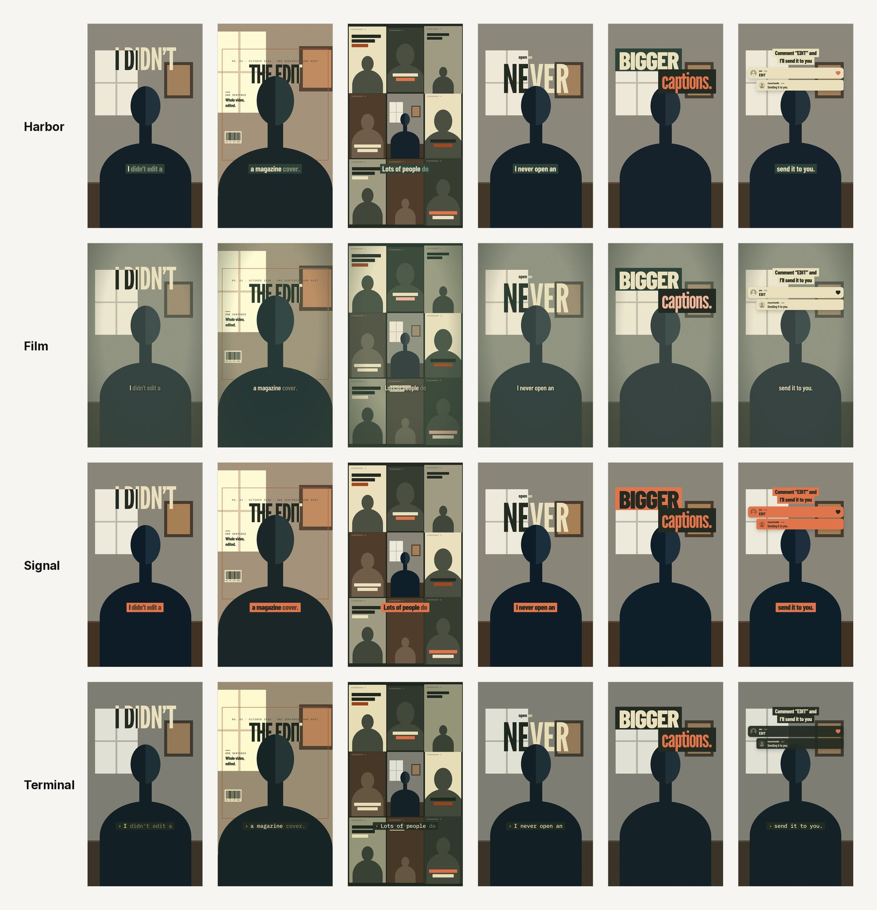
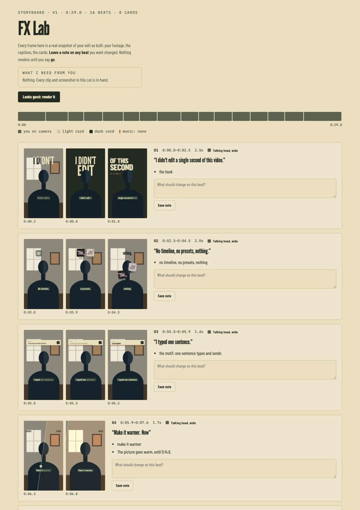
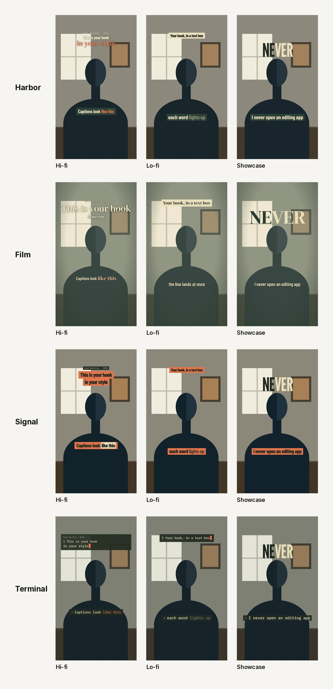
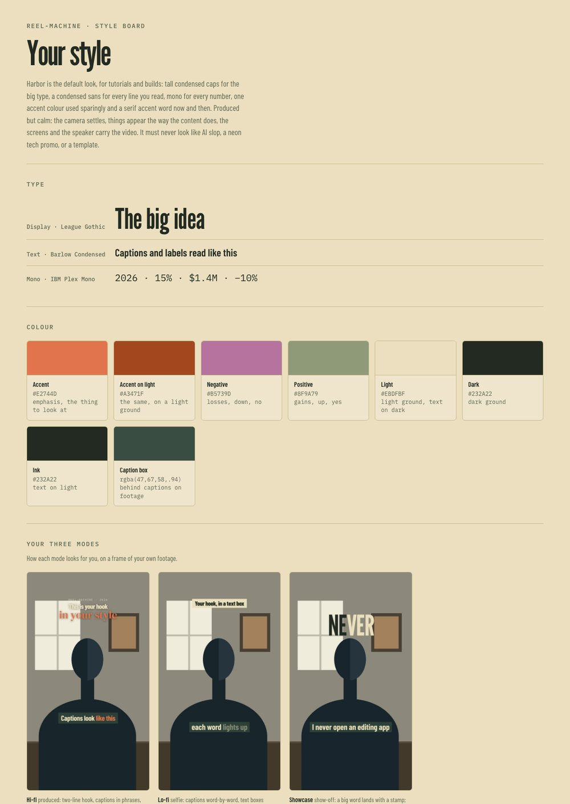
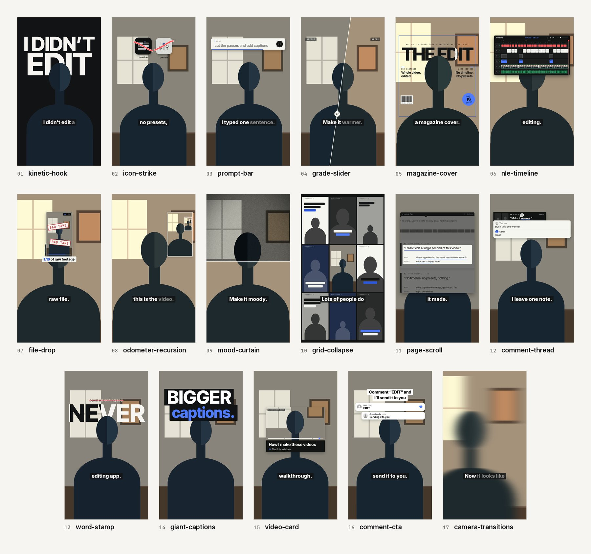

# reel-machine

**Raw talking-head takes in, a finished vertical video out, in your own style.**

[](LICENSE) [](#install) [](#install)

An AI agent skill that turns your raw talking-head takes into a finished vertical video for Reels, TikTok and
Shorts. Drop in your takes: it cuts the edit, writes the captions, builds the motion graphics and lays the sound,
and checks each step with you before the final renders. It runs on your computer, on your footage. Free and open
source.


<sub>One edit, four style packs. Same cut, same effects, same timing; the look is the pack's. Every image in this
README is drawn on a stand-in figure.</sub>

## Quick start
1. Paste this into [Claude Code](https://claude.com/claude-code):
   ```text
   Install the reel-machine skill:
   clone https://github.com/Jacobmedford/reel-machine into ~/.claude/skills/reel-machine,
   then run python3 ~/.claude/skills/reel-machine/setup/setup.py until it prints READY.
   ```
2. Start Claude Code with `claude --model opus --effort max`, type `/reel-machine` and drop in your takes.
3. Pick a mode and a style on the start page, approve the first cut, the hook and the storyboard, and your video
   lands in the project folder.

On Codex, Claude Cowork or ChatGPT Work instead? See [Install](#install). What you need: a Mac or Linux computer
with ffmpeg, Node 22+, Python 3.10+ and about 6 GB free; setup installs everything else and tells you the exact fix
for anything missing.

> [!TIP]
> **Best results** at the time this repo was published (October 2026): **Claude Opus 5.5 on max effort**. In Claude
> Cowork, pick Opus 5.5 and the highest effort in the model menu. On Codex and ChatGPT Work, use the most capable
> model at its highest reasoning effort.

## What it makes
- A clean edit of your takes: dead air out, the last good take of every line, J-cuts on every join, two framings
  from one camera, lip sync checked before and after the render.
- Captions that land on the words, in your fonts and colours.
- Words and numbers behind your head (you stay in front of the type).
- Hand-built motion-graphic cards for the numbers in your script: charts that draw, figures that roll, data kept
  to scale.
- Sound effects under every visual moment, mixed under your voice to streaming loudness (-14 LUFS).
- Three stops before the final: the first cut, the hook, and a storyboard of every beat with real frames. Leave
  notes on any of them. Nothing final renders until you say go.

## How it works
1. **Install it once** (below). Setup installs what's missing and gives you the exact fix for anything it can't.
2. **First run:** "Use the Harbor palette, or your own brand colors?" Keep Harbor, or hand it a brand file, your
   website, 2 or 3 videos whose style you like, or answers to four questions. All four style packs come out in your
   colours, and a style board shows you the result.
3. **Drop your takes** into the chat with `/reel-machine`: one clip, several, or a folder, plus what the video is
   about (`/reel-machine ~/Videos/take-1.mov ~/Videos/take-2.mov, about this article: <link>`). It copies them into
   a new project (your files are never changed), puts them in the order you recorded them and joins them into one
   source. The transcript starts right away.
4. **The start page** opens: each take with a thumbnail, its length and its first line, the three modes with an
   example clip each, your styles, and what to send. It recommends a mode from your footage (a phone in hand: lo-fi;
   a tripod and 4K: hi-fi) and asks for the mode, the style and any links, screenshots or videos.
5. **Assets:** links it captures itself (a repo's README, an article's exact paragraph, a scroll through a page).
   Anything only you have (a dashboard, anything behind a login) goes on a "what I need from you" list with exactly
   what to send. It never guesses.
6. **Three stops:** the first cut (approve the pace), the hook (the opening, rendered for real in under a minute)
   and the storyboard (every beat with real frames, what moves and what you hear). Comment on any of them.
7. **The final** renders and has to pass QA before you get it. The video and a phone-size copy land in the project
   folder.
8. **Notes on the final** re-render only the 5-second pieces they touch.

The pages open as Claude artifacts with inline comments when you use Claude, or as local pages on your computer
anywhere else (your notes save to a file the agent reads). How to film for it: [`SHOOTING.md`](SHOOTING.md).

<p align="center"></p>

## The safety net
Nothing final renders until you approve the storyboard, and nothing is delivered unless it passes QA: a check for
frozen graphics, every cut read for flashes and wrong frames, lip sync within two frames, loudness at -14 LUFS.
Your takes are copied, never changed, and every video keeps the style it was made with, so old projects render the
same after you change your look.

## Three modes
- **Hi-fi**: produced. A sit-down take, full-screen data cards, type behind your head.
- **Lo-fi**: selfie. A phone take where you never leave the frame; screenshots and clips land on top of you or
  behind your head, captions light up word by word, native-looking text boxes carry the hook and the call to action.
- **Showcase**: the show-off edit. Every line gets a different hand-built motion graphic the words call for (kinetic
  type, a magazine cover behind your head, a grade that wipes across, a grid of you, a timeline that builds), a
  different transition on every cut, and dense sound. Seventeen effects ship in the library.

<p align="center"></p>

## Four styles
The kit ships four style packs, all drawn in the Harbor palette on open fonts. The first run can recolor all four
in your brand colours (and your text face, if you have one).
- **Harbor**, the default: tutorials and builds.
- **Film**: stories; slower, with a film grade.
- **Signal**: proof, results and news; the fastest.
- **Terminal**: builds and screen recordings, with mono captions.

Your style decides how each mode edits for you, not just its colours: the hook shape, how captions move, what the
camera does, which transitions you use and how a big word lands. Change anything, any time: "update my style".

Your packs live in `~/reel-machine/` (`style/` is the default, `packs/<name>/` the others), outside the skill, so
updates never touch them. Each video keeps a copy of the style it was made with.

<p align="center"></p>

## The effects
Seventeen hand-built motion graphics for showcase videos, each one driven by your style pack: kinetic type, a word
stamped behind your head, giant captions, a typing prompt bar, comment threads, a magazine cover, an editing
timeline built from your own video, a grade that wipes across, a grid of you, a frame that recurses into itself,
and more. What each one does and when to reach for it: [`fx/LIBRARY.md`](fx/LIBRARY.md). Thirteen presets (effects,
cards and lo-fi devices) are ready to use by setting a few values: [`presets/CATALOG.md`](presets/CATALOG.md).



## Install
What you need: a Mac or a Linux computer (Windows through WSL2; native Windows is untested) with ffmpeg, Node 22+ and
Python 3.10+, and about 6 GB free. The setup script checks everything, prints the exact fix for anything missing,
and draws a test frame, so READY means it can render.

| Where you use it | Install it | Start it |
|---|---|---|
| [Claude Code](#claude-code) (recommended) | one prompt, or clone into `~/.claude/skills` and run setup | `/reel-machine` |
| [Claude Cowork](#claude-cowork) | upload `reel-machine.zip` as a skill | ask for reel-machine in a Cowork task |
| [Codex](#codex) | clone into `~/.agents/skills`, run setup | `$reel-machine` |
| [ChatGPT Work](#chatgpt-work) | upload `reel-machine.zip` as a skill | `@reel-machine` in a Work task |

Tested in Claude Code on macOS. Codex runs the same steps on your computer, and Cowork and ChatGPT Work inside their
own sandboxes.

### Claude Code
Paste this into Claude Code:
```text
Install the reel-machine skill:
clone https://github.com/Jacobmedford/reel-machine into ~/.claude/skills/reel-machine,
then run python3 ~/.claude/skills/reel-machine/setup/setup.py until it prints READY.
```

Or do it yourself:
```sh
git clone https://github.com/Jacobmedford/reel-machine ~/.claude/skills/reel-machine
python3 ~/.claude/skills/reel-machine/setup/setup.py
```
Then start Claude Code with `claude --model opus --effort max` and type `/reel-machine`. To update later:
`git -C ~/.claude/skills/reel-machine pull`, then run setup again.

### Claude Cowork
Cowork (the Claude desktop app) runs tasks in a Linux sandbox on your computer that can only reach the folders you
give it.
1. Get `reel-machine.zip` from the repo's latest release.
2. In the Claude desktop app: Customize > Skills, then + > Create skill > Upload a skill, and pick the zip.
3. In Settings > Capabilities, turn on code execution and file creation.
4. Make a folder for your videos, for example `reel-machine` in your home folder, and put your clips in it. Start a
   Cowork task, give it access to that folder, and ask: "Use reel-machine to make a hi-fi video from my-clip.mov."
5. The first run sets the kit up inside the sandbox: ffmpeg, Node, a render browser and the speech model (a few GB,
   10 to 20 minutes the first time). Your style, projects and finished videos are saved in the folder you gave it,
   so they stay on your computer. Renders use the sandbox's processor: slower than Claude Code, same result.

If the sandbox can't install software or reach the internet on your setup, use Claude Code instead.

### Codex
For the Codex CLI, the IDE extension or the Codex tab in the ChatGPT desktop app, clone it into your Codex skills
folder and run setup:
```sh
git clone https://github.com/Jacobmedford/reel-machine ~/.agents/skills/reel-machine
python3 ~/.agents/skills/reel-machine/setup/setup.py
```
Then type `$reel-machine`, or ask Codex to edit your clip with reel-machine. Codex runs commands in a sandbox that
blocks the browser the kit renders with, so give the session Full access (the permissions menu in the app, or
`codex --sandbox danger-full-access`); setup tells you if it can't render.

### ChatGPT Work
ChatGPT Work runs in the new ChatGPT desktop app (not ChatGPT Classic) and does its local work through the Codex
built into it.
1. Get `reel-machine.zip` from the repo's latest release.
2. In ChatGPT: your profile icon > Skills, then upload the zip. ChatGPT scans uploaded skills and may mark this one
   "Needs review" because it contains code; that's expected.
3. Make a folder for your videos, for example `reel-machine` in your home folder, put your clips in it, and open it
   in a Work task so ChatGPT has access to it.
4. Rendering opens a headless browser, which the Codex sandbox blocks: give the task Full access when it asks.
5. Ask: "@reel-machine make a lo-fi video from my-clip.mp4." The first run sets the kit up in that folder (a few
   minutes, once).

### Where everything goes
Setup makes the kit's own Python environment and downloads GSAP (checked against its checksum) into
`~/reel-machine/` (or the folder you gave Cowork or ChatGPT), next to your style and your projects, never inside the
skill folder. The speech model (about 1.5 GB) goes in the Hugging Face cache in your user folder, and the render
browser in npm's and the browser's own caches there (on a Linux where those builds don't start, setup installs
Chromium in `~/reel-machine/browsers/` instead). Run setup again any time; it only fixes what's missing, and
`--check` reports without changing anything.

Put the repo in a skills folder, never in `~/reel-machine` itself: that folder is where your style and videos live.
If setup finds the kit there, it stops and prints the command that moves it.

Each project's `edit.py` is Python that the agent writes and the kit runs. Only open projects you or your agent
made, never one someone sends you.

### Update or remove it
- **Update:** `git -C ~/.claude/skills/reel-machine pull` (Codex: `~/.agents/skills/reel-machine`), then run setup
  again. Your style, packs and projects live in `~/reel-machine/`, so an update never touches them. Cowork and
  ChatGPT Work: upload the new release zip in place of the old one.
- **Remove:** delete the skill folder. Your style, presets and videos stay in `~/reel-machine/` until you delete
  that too (copy out anything you want to keep first).

## Make it yours
You don't need to fork anything to make videos in your own look: the first run builds your style, and every pack,
preset and project lives in your own `~/reel-machine/` folder. Fork the repo only to change the kit itself (an
effect, a card, the pipeline); then clone your fork into the skills folder instead, and pull from it to update.

## Your own sounds
The kit ships 20 sound effects made from scratch for it. To add your own, put them in your reel-machine folder:
- **Favorites:** files in `~/reel-machine/sfx/favorites/`, named `fav-<name>.wav` (or .mp3, .m4a, .aif, .flac).
- **A bigger library:** list it in `~/reel-machine/sfx/library/index.json` as
  `[{"name": "lib-<name>", "path": "<where the file is>"}, ...]`. Nothing is copied; the files stay where they are.

The agent calls every sound by name, and a file in a project's own `audio/` folder wins over all of them.

## Extend it (optional)
Everything above works out of the box with real footage, real screenshots and the kit's own sound effects. Connect
any of these to your agent to go further; the skill uses what it finds and skips what it doesn't.

| Add-on | Unlocks | How |
|---|---|---|
| [Higgsfield](https://higgsfield.ai) MCP | Generated images and video for beats no real footage can show, plus music and sound effects | Add `https://mcp.higgsfield.ai/mcp` as an MCP server or connector and sign in |
| [ChatCut](https://chatcut.io) | Original music for each video and a sound-effects library | Install ChatCut's plugin or connector and sign in |
| [ElevenLabs](https://github.com/elevenlabs/elevenlabs-mcp) MCP | Generated sound effects from a description | Add the official ElevenLabs MCP server with your API key |
| [Suno](https://suno.com), or any track you own | Your own music under the video | Download the track, drop it in the project's `audio/` folder, tell the agent to use it |

Music is off by default. Most creators add a track when they post (Instagram, Edits, TikTok, CapCut), where it
can be a licensed trending sound. Generated images are used sparingly and tagged on the storyboard so you can cut
any of them before the render.

## Troubleshooting
- **Setup says NOT READY.** Every MISSING line ends with the exact fix for your computer. Run it, then run setup
  again; it only redoes what's missing. `python3 <skill folder>/setup/setup.py --check` reports without changing
  anything.
- **"BLOCKED" or the render test fails in Codex or ChatGPT Work.** Their sandbox stops the render browser. Give the
  session Full access, then run setup again.
- **Setup stops and says the kit is in your reel-machine folder.** You cloned it into `~/reel-machine`, where your
  style and videos go. Run the move command it prints.
- **"no speech found in <take>".** That take has no voice the transcriber can hear (a muted mic, or B-roll). Leave
  it out, or say which take is the talking one.
- **A word got cut.** Tighten trims pauses by loudness, and a very soft word can read as a pause. Say which line on
  the first-cut page; the agent puts that line's pauses back.
- **Anything else:** open an issue with your computer and agent, what you asked for, and the output of
  `setup.py --check`. Leave out private footage, keys and client names.

## What's inside
```
SKILL.md              the instructions every agent reads
SHOOTING.md           how to film so the kit gives you its best cut
modes/                hi-fi, lo-fi and showcase: how each edit is structured
onboarding/           style setup: ONBOARDING.md, refs.py (studies inspiration videos), board.py (the style board)
pipeline/             intake, cut, transcribe, cutout, build, mix, storyboard, QA, render, packs, presets (Python)
kit/                  the composition's CSS, the card and effect briefs, the style token and style pack references
cards/                the motion-graphic card library (LIBRARY.md), each card driven by your tokens
fx/                   the showcase effects library (LIBRARY.md), each effect driven by your tokens
presets/              effects and cards ready to use by setting a few values (CATALOG.md)
packs/                the four style packs (harbor, film, signal, terminal) with their open fonts
audio/sfx/            sound effects, synthesized from scratch for this kit (CC0)
storyboard/           the start, approval and storyboard pages, their example clips, a local server, and
                      artifact.py, which packs a page for a Claude artifact
examples/             a reference edit.py for each mode, and three small sample packs the tests use
setup/                setup.py and package.py (builds reel-machine.zip)
dev/                  the kit's own test bench: a drawn stand-in figure, the effects lab, the README images
tests/                the test suite
docs/img/             the README images (dev/readme_shots.py regenerates them)
```

## Credits and licenses
reel-machine is MIT licensed (see `LICENSE`). It stands on:
- [HyperFrames](https://github.com/heygen-com/hyperframes) (Apache-2.0): renders the video from HTML. Run through
  npx, pinned to one version.
- [GSAP](https://gsap.com) (GreenSock standard license, free): the animation timeline. Downloaded by setup, not
  included here.
- [faster-whisper](https://github.com/SYSTRAN/faster-whisper) (MIT): word-level transcription.
- [Robust Video Matting](https://github.com/PeterL1n/RobustVideoMatting) (GPL-3.0): the optional smoother cutout.
  Its model is downloaded only if you run `setup.py --matte`; none of its code is in this repo.
- Fonts: the packs ship [League Gothic](https://fonts.google.com/specimen/League+Gothic) and
  [DM Serif Display](https://fonts.google.com/specimen/DM+Serif+Display) under the SIL Open Font License (each
  with its `OFL.txt`); every other face is fetched from [Google Fonts](https://fonts.google.com) for your pack.
- The sound effects are synthesized by `audio/make_sfx.py` and released CC0.
- The $1 bill in the `dollar-split` card is a US government work in the public domain.
